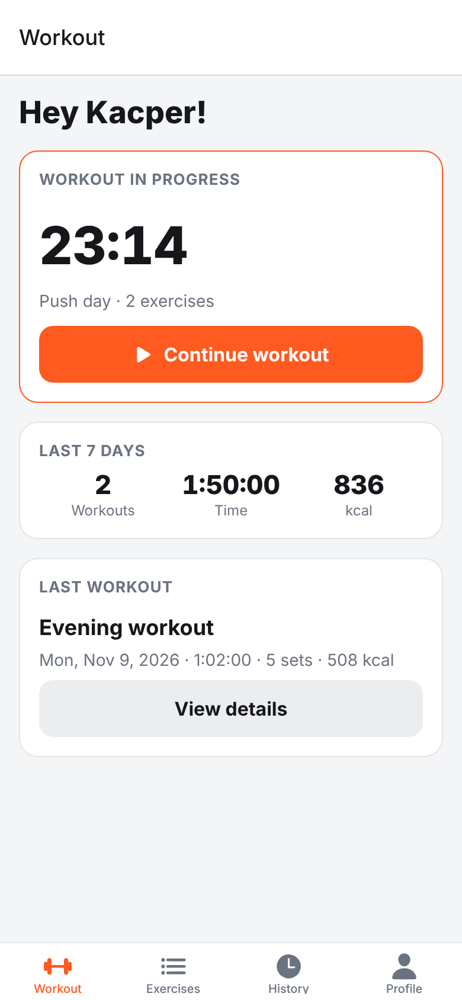
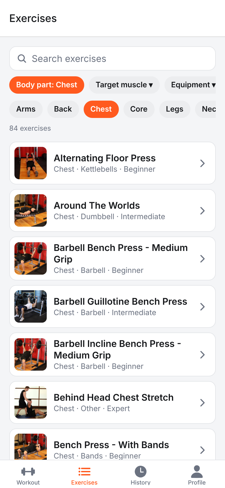
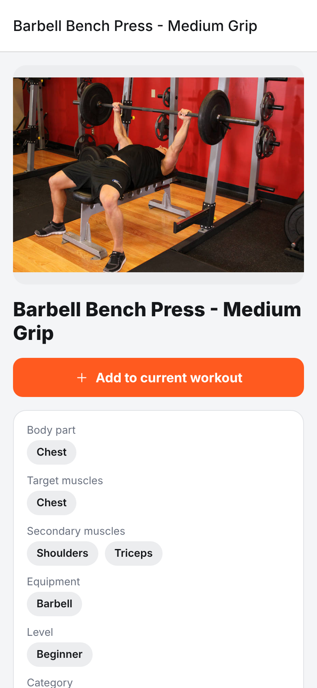
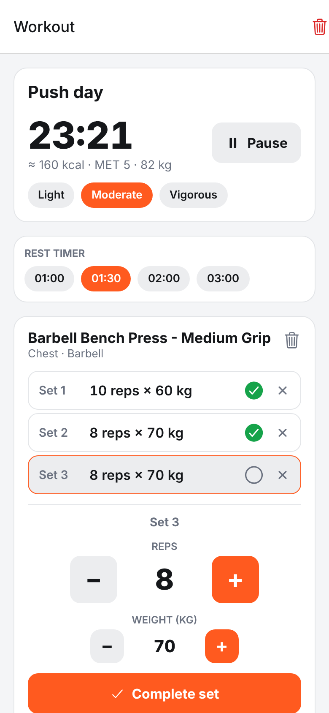
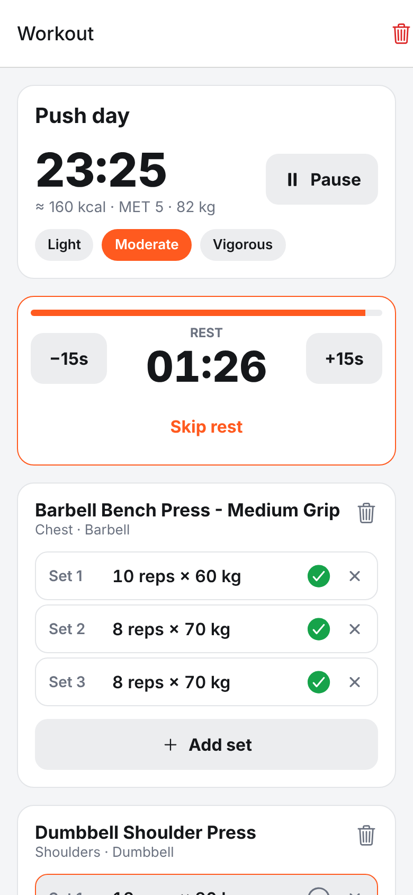
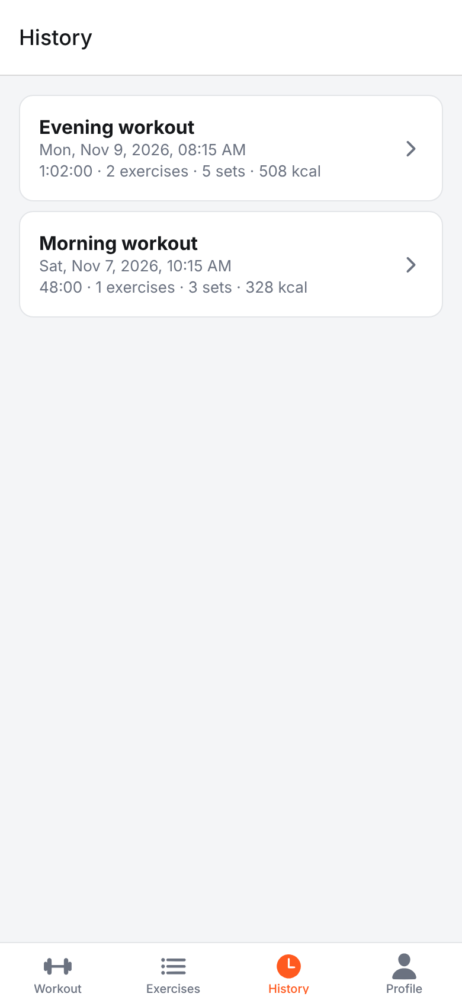
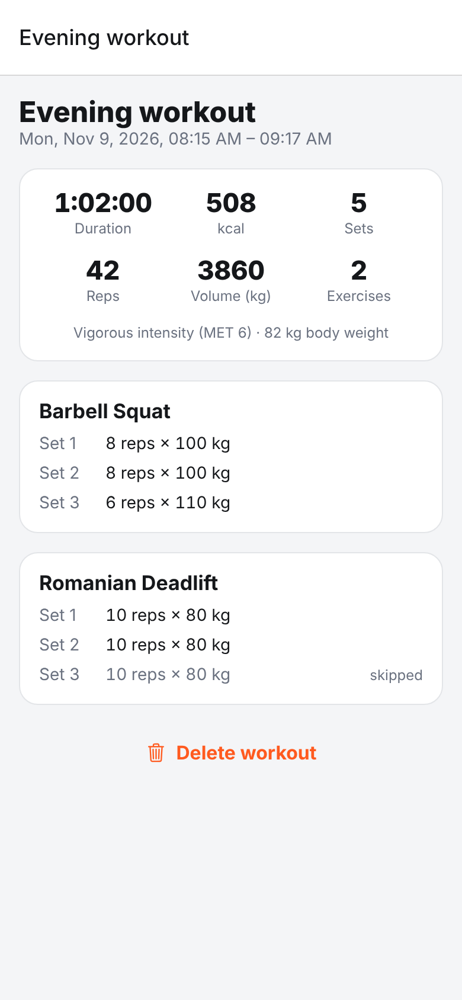
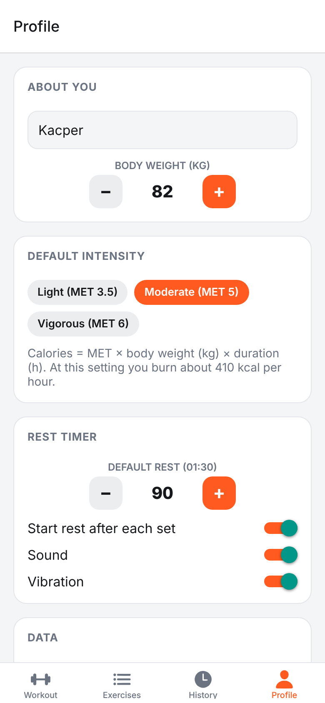

# OneMoreRep

A mobile app for tracking gym workouts: count reps, browse an exercise catalog, estimate burned calories and time your rest. Built with React Native (Expo + TypeScript). See [docs/project-description.md](docs/project-description.md) for the full project description.

## Screenshots

| Home | Exercise catalog | Exercise details | Active workout |
| :---: | :---: | :---: | :---: |
|  |  |  |  |

| Rest timer | History | Workout details | Profile |
| :---: | :---: | :---: | :---: |
|  |  |  |  |

## Getting started

```bash
npm install
npm start          # Expo dev server, open in Expo Go or a simulator
npm run android    # or: npm run ios / npm run web
```

Checks:

```bash
npm run typecheck
npm test
```

## Project structure

```
src/
  app/                    Expo Router screens
    (tabs)/               Workout (home), Exercises, History, Profile
    workout.tsx           Active workout: stopwatch, rep counter, sets, rest timer
    pick-exercise.tsx     Exercise picker (modal)
    exercise/[id].tsx     Exercise details
    history/[id].tsx      Finished workout details
  components/             UI components (Stepper, RestTimerBar, ExerciseCatalog, ...)
  lib/                    Pure logic: types, MET calories, formatting, exercise filtering (+ tests)
  services/
    exerciseApi.ts        The only module that talks to the exercise data source
    storage.ts            AsyncStorage helpers
  state/
    AppStore.tsx          Profile, active workout and history (persisted locally)
    RestTimer.tsx         Rest countdown with sound and vibration
```

## Exercise data

Exercises come from [free-exercise-db](https://github.com/yuhonas/free-exercise-db) (public domain, ~870 exercises). The JSON file is downloaded once, cached on the device and refreshed weekly; search and filters run locally, so there are no API keys or rate limits and the catalog works offline.

To self-host the data, put `exercises.json` and the `exercises/` image folder on any static host and set `extra.exerciseData.url` / `extra.exerciseData.imageBaseUrl` in `app.json` (or the `EXPO_PUBLIC_EXERCISES_URL` / `EXPO_PUBLIC_EXERCISE_IMAGES_URL` env vars).

## Calories

`Calories = MET x body weight (kg) x duration (hours)`, with MET 3.5 / 5.0 / 6.0 for light / moderate / vigorous resistance training. Body weight and default intensity are set in the Profile tab; intensity can be changed per workout.
